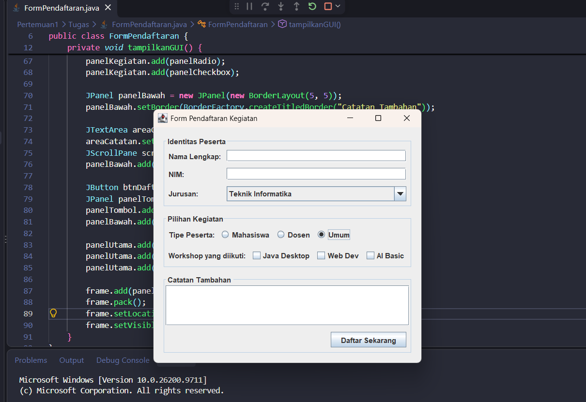
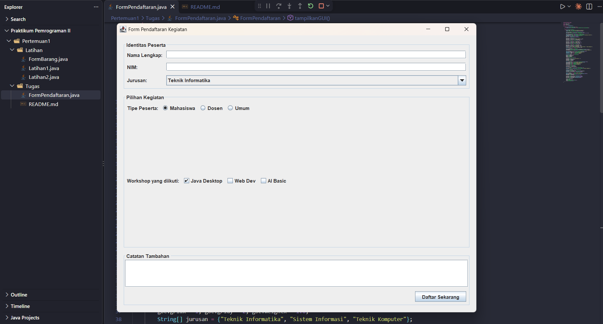

# Tugas 1 - Dasar GUI Swing dan Layout

## Informasi Mahasiswa
- **Nama:** Erik Adia Meka
- **NIM:** 243040013
- **Mata Kuliah:** IF21W0508 - Praktikum Pemrograman II

## Spesifikasi Lingkungan
- **JDK:** Java 21 (LTS)
- **IDE:** Visual Studio Code (dengan Extension Pack for Java)

## Cara Menjalankan Aplikasi
1. Buka folder proyek ini di Visual Studio Code.
2. Buka file `FormPendaftaran.java` yang berada di dalam folder `Pertemuan1/Tugas`.
3. Klik tombol **Run** (ikon segitiga play) di pojok kanan atas editor, atau klik kanan pada editor dan pilih **Run Java**.
4. Jendela aplikasi "Form Pendaftaran Kegiatan" akan muncul.

## Bukti Uji (Screenshot)

**1. Tampilan Awal:**

**2. Tampilan Setelah Resize:**
